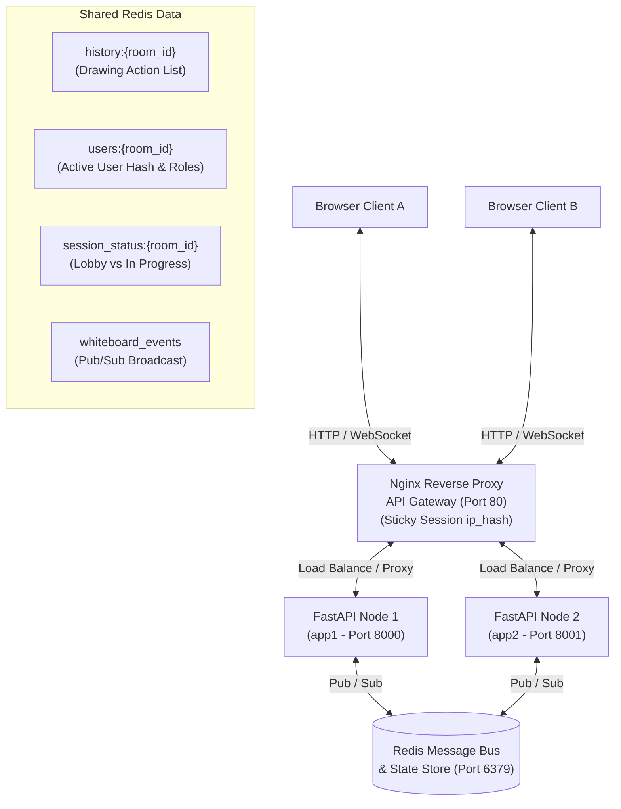
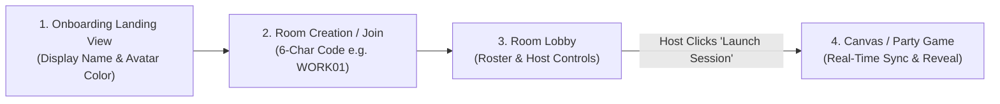

# 🎨 CollabDraw - Master Technical Documentation & Feature Guide

**CollabDraw** is a production-ready, horizontally scalable, real-time collaborative whiteboard platform built with an **Nginx API Gateway**, **Python FastAPI + Redis Pub/Sub** backend, and a modern dark-mode **HTML5 Canvas + Vanilla JavaScript** frontend.

---

## 🏗️ 1. Architecture Overview & Technology Stack

CollabDraw is engineered for sub-millisecond drawing synchronization across distributed server nodes with a single unified entry point via Nginx.



### 🛠️ Core Technology Stack

| Layer | Technology | Purpose |
| :--- | :--- | :--- |
| **API Gateway / Proxy** | **Nginx** | Reverse proxy, sticky session load balancing (`ip_hash`), WebSocket upgrades |
| **Backend Framework** | **Python FastAPI** (`asyncio`) | Asynchronous WebSocket endpoint handling & REST endpoints |
| **Message Bus** | **Redis Pub/Sub** (`redis.asyncio`) | Multi-node message fanout & cluster state management |
| **Frontend Engine** | **Vanilla HTML5 Canvas + JS** | High-performance 2D rendering without external JS framework bloat |
| **UI Design System** | **Glassmorphism + Vanilla CSS** | Neon accents, backdrop blur filters, dark mode (`Outfit` font) |
| **Icons & Assets** | **Self-Contained SVGs** | 100% offline icon rendering with zero external CDN dependencies |

---

## 🔄 2. Enterprise User Flow & Feature Matrix

CollabDraw follows a complete 4-stage enterprise collaboration lifecycle:



### 🚪 A. User Onboarding & Landing View (`#landingModal`)
1. **Profile Onboarding**:
   - Requires Display Name input and Avatar Badge Color selection.
   - Saves preferences to local client storage.
2. **Room Generation & Joining**:
   - **Create Room**: Generates a unique 6-character room code (e.g. `WORK01` or `X7K9P2`) and registers the creating client as room `Host`.
   - **Join Room**: Allows entering any 6-character room code to join an existing session as an `Editor` or `Viewer`.

---

### 🏰 B. Room Lobby & Participant Roles (`#lobbyModal`)
1. **Redis Participant Role Tracking (`users:{room_code}`)**:
   - Participant records stored in Redis (`users:{room_code}`) track `client_id`, `name`, `color`, `role` (`Host`, `Editor`, `Viewer`), `is_host`, and `can_draw`.
   - **Host Auto-Promotion**: If the current room `Host` disconnects, the backend automatically promotes the oldest remaining participant to `Host`, updates Redis state, and broadcasts a `role_changed` event.
2. **Host Control Panel**:
   - **Drawing Permissions Toggle**: Host can lock/unlock drawing permissions (`lock_drawing` / `unlock_drawing`). When locked, non-host participants are set to `Viewer` mode and client/server block drawing actions.
   - **Session Mode Selector**: Host can switch room modes between Collaborative Canvas and Blind Chain Draw Party Game.
3. **Synchronized Session Launch**:
   - When the Host clicks **"🚀 Launch Session"**, the client sends a `start_session` event.
   - The backend sets `session_status:{room_id}` to `"in_progress"` and broadcasts `start_session` across Redis Pub/Sub, causing all connected peers across all nodes to transition simultaneously from the Lobby to the active session.
4. **Session-in-Progress Late-Join Guard**:
   - When a new participant attempts to join an active session after it has been launched, the server rejects the connection and returns a `session_in_progress` payload.
   - The frontend displays a dedicated **🔒 Session In Progress** alert card and safely returns late joiners to the landing page.

---

### 🎨 C. Expanded Whiteboard Toolset & Remote Cursor Engine
1. **Full Drawing Toolset**:
   - **Pen**: Smooth freehand drawing with customizable stroke color and size.
   - **Straight Line**: Line creation with live rubber-band draft preview.
   - **Rectangle**: Box shape creation with live draft preview.
   - **Circle**: Circle shape creation with center & radius draft preview.
   - **Eraser**: Freehand eraser brush.
   - **Sticky Note**: Interactive DOM overlay cards supporting text editing, drag-and-drop repositioning, header color selection, and real-time syncing (`sticky_create`, `sticky_update`, `sticky_delete`).
2. **~30 FPS Remote Cursor Overlay**:
   - Rendered on an absolute CSS overlay layer (`#cursorOverlay`) with `pointer-events: none`.
   - Outgoing cursor position updates are throttled on the client to ~30 FPS (~35ms interval).
   - Displays cursor icon, user's display name, and avatar color tag.
3. **Multi-Format Exporting**:
   - **PNG Export** (`exportBtn`): High-DPI bitmap image export.
   - **SVG Export** (`exportSvgBtn`): Vector SVG graphics document parsing action history and sticky notes.
   - **PDF Export** (`exportPdfBtn`): Multi-element document export powered by `jsPDF`.

---

### 🎮 D. Blind Chain Draw Party Game Workflow
1. **Turn-Based Hidden Drawing**:
   - Each player is assigned a turn index and draws their portion of the prompt without seeing active strokes of current peers.
2. **Masterpiece Reveal & Award Ceremony**:
   - Combined sharp layer reveal with high-resolution particle confetti physics.
   - Anonymous voting for *Most Creative* and *Most Chaotic*.
3. **Strict Host Controls & Participant Request System**:
   - **Host Controls**: Only the Host sees `Proceed to Voting 🏆` and `Play Next Round 🔄`.
   - **Participant Request System**: Non-host participants see **`📩 Request Host to Start Voting`** and **`📩 Request Host for Next Round`**, which broadcast real-time request alerts and glowing button badges on the Host's screen.
4. **Room Lobby Re-Routing**:
   - Clicking **Return to Lobby 🏰** closes game modals and re-routes everyone back to the **Room Lobby**, preserving host state and player rosters.

---

## 📡 4. API & WebSocket Protocol Reference

### REST Endpoints

#### `GET /health`
Returns node status, active connections, and Redis connection state.
```json
{
  "status": "online",
  "node_id": "node-8000",
  "redis_connected": true,
  "local_rooms": 1,
  "local_connections": 3
}
```

#### `GET /api/rooms`
Returns cluster-wide active room roster and participant counts.
```json
{
  "node_id": "node-8000",
  "rooms": [
    { "room_id": "WORK01", "user_count": 3 },
    { "room_id": "DESIGN", "user_count": 1 }
  ]
}
```

---

### WebSocket Protocol (`WS /ws/{room_id}`)

Query parameters: `?client_id=user-xyz&name=Alex&color=%2338bdf8`

| Message Type | Direction | Payload Example | Action Description |
| :--- | :--- | :--- | :--- |
| **`init`** | Server $\rightarrow$ Client | `{ "type": "init", "history": [...], "users": [...], "role": "Host" }` | Initial room state sent on connection |
| **`user_joined`** | Server $\rightarrow$ Client | `{ "type": "user_joined", "name": "Alex", "color": "#38bdf8", "role": "Editor" }` | Broadcast when a new peer enters room |
| **`user_left`** | Server $\rightarrow$ Client | `{ "type": "user_left", "client_id": "user-xyz" }` | Broadcast when a peer disconnects |
| **`role_changed`** | Server $\rightarrow$ Client | `{ "type": "role_changed", "host_client_id": "user-123", "users": [...] }` | Broadcast when host is re-assigned |
| **`update_room_permissions`** | Client $\rightarrow$ Server | `{ "type": "update_room_permissions", "drawing_locked": true }` | Host toggles drawing lock / user roles |
| **`permissions_updated`** | Server $\rightarrow$ Client | `{ "type": "permissions_updated", "drawing_locked": true, "users": [...] }` | Broadcast room permission updates |
| **`start_session`** | Bidirectional | `{ "type": "start_session", "room_id": "WORK01", "mode": "whiteboard" }` | Host launches session, transitioning all peers |
| **`session_in_progress`** | Server $\rightarrow$ Client | `{ "type": "session_in_progress", "room_id": "WORK01", "error": "..." }` | Sent when rejecting late joiners to an active session |
| **`start_game`** | Bidirectional | `{ "type": "start_game" }` | Host initiates Blind Chain Draw Party Game |
| **`start_voting`** | Bidirectional | `{ "type": "start_voting" }` | Host proceeds to category voting phase |
| **`request_next_round`** | Bidirectional | `{ "type": "request_next_round", "name": "Barry", "request_kind": "voting" }` | Participant requests Host to start voting or next round |
| **`draw`** | Bidirectional | `{ "type": "draw", "tool": "pen", "points": [...], "color": "#ffffff", "size": 4 }` | Drawing stroke action |
| **`cursor`** | Bidirectional | `{ "type": "cursor", "x": 0.45, "y": 0.32, "name": "Alex", "color": "#38bdf8" }` | Normalized cursor position update (~30 FPS) |
| **`sticky_create`** | Bidirectional | `{ "type": "sticky_create", "note_id": "sticky-123", "x": 0.4, "y": 0.4, "color": "#fef08a", "text": "Note" }` | Create sticky note card |
| **`sticky_update`** | Bidirectional | `{ "type": "sticky_update", "note_id": "sticky-123", "x": 0.42, "y": 0.41, "color": "#bbf7d0", "text": "Updated" }` | Reposition or edit sticky note |
| **`sticky_delete`** | Bidirectional | `{ "type": "sticky_delete", "note_id": "sticky-123" }` | Remove sticky note card |
| **`chat`** | Bidirectional | `{ "type": "chat", "text": "Hello team!", "name": "Alex", "color": "#38bdf8" }` | Text chat message |
| **`undo`** | Bidirectional | `{ "type": "undo" }` | Revert last action |
| **`clear`** | Bidirectional | `{ "type": "clear" }` | Clear room history |
